# Лабораторная работа 6: Введение в FastAPI

## №1 Подготовительный этап
Создание проекта, настройка uv, первый коммит.

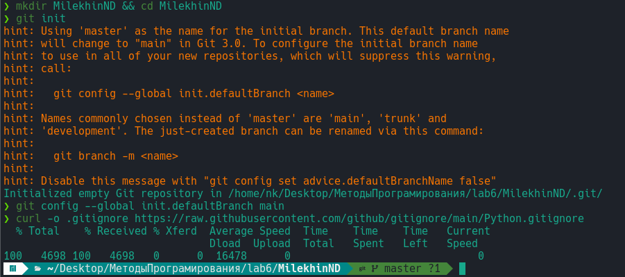
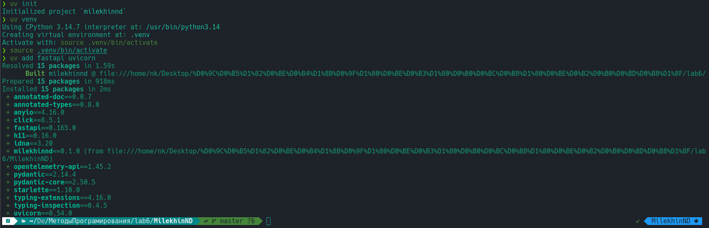
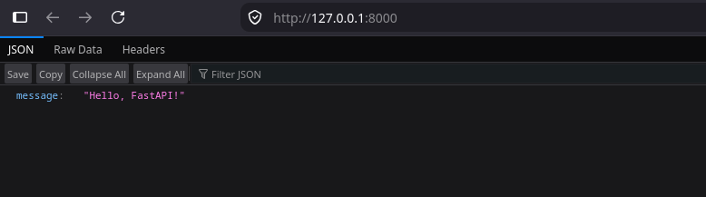
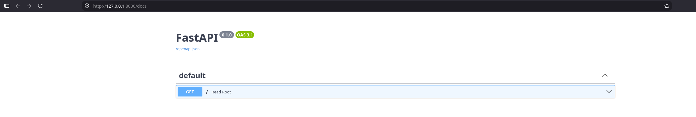
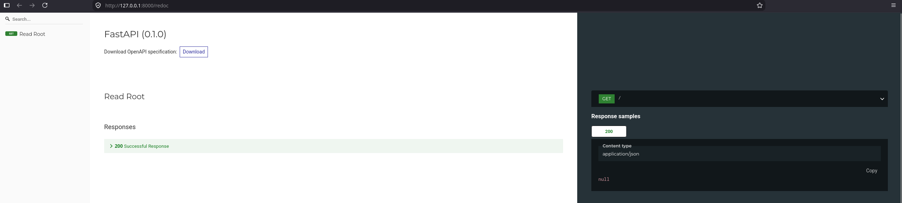
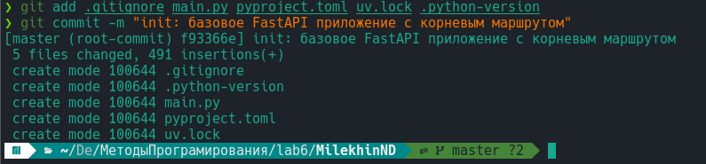

## №2 Эндпоинт с параметрами пути и query
Добавление `/items/{item_id}` и тестирование.

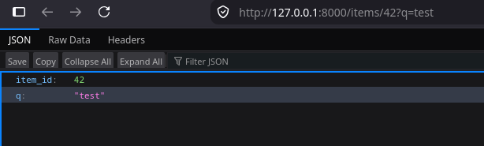
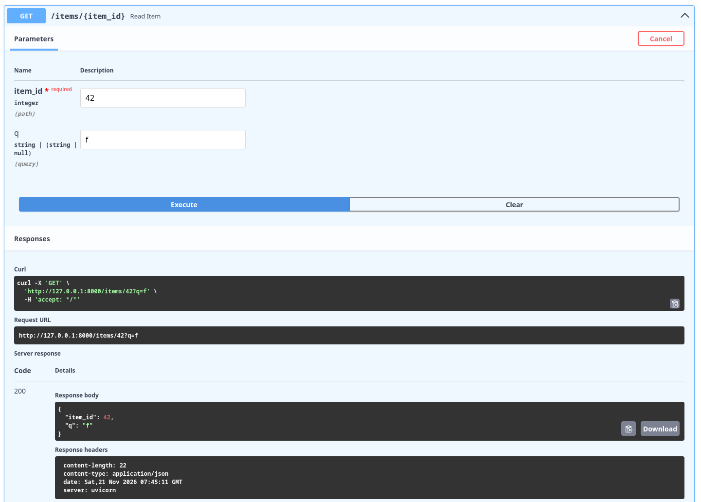
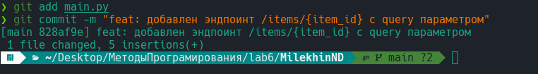

## №3 Модель Pydantic и POST-запрос
Создание модели `Item` и эндпоинта `POST /items/`.

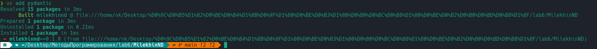
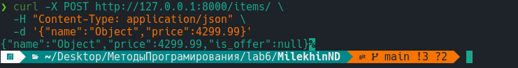
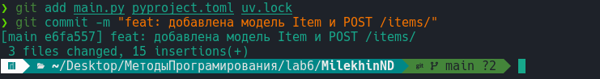

## №4 Организация кода (Роутеры)
Вынос маршрутов в `app/routers/items.py`.

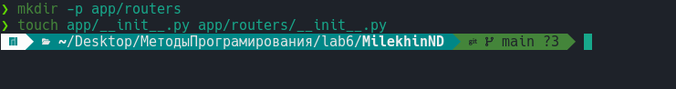
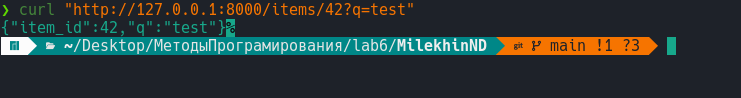
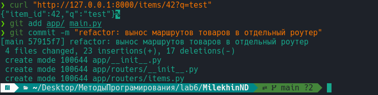

## №5 Конфигурация через Pydantic Settings
Настройка `.env` и `app/config.py`.

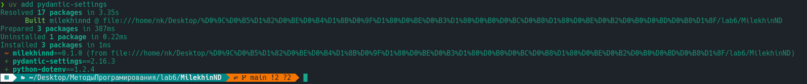
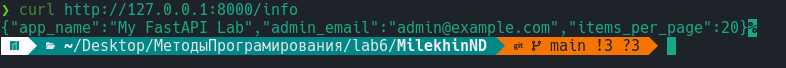
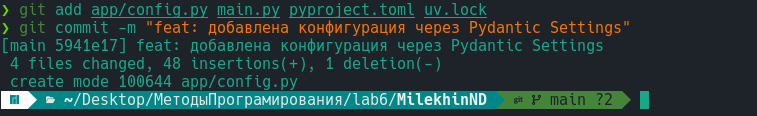

## №6 Обработка ошибок и документация
Добавление `HTTPException`, `Path`, `Query`, `Field` и метаданных.

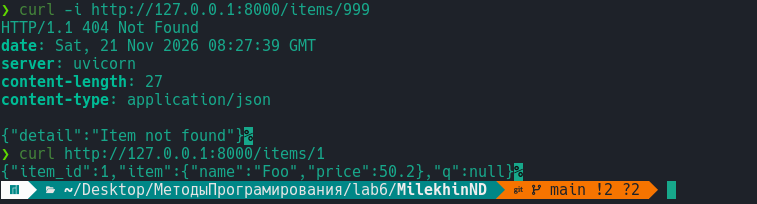
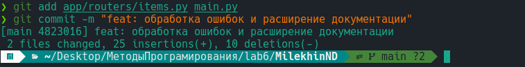

## №7 Самостоятельная работа (PUT)
Обновление товара и валидация уникальности имени.

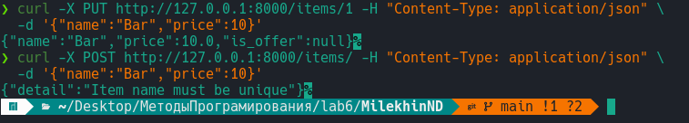
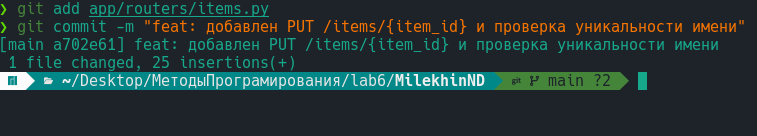

## №8 Самостоятельная работа (Логирование)
Добавление логирования.

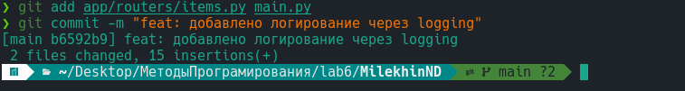
